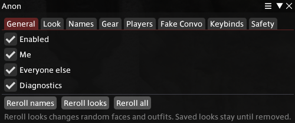

# Anon

Anon is a Dalamud plugin for FFXIV that hides who you and the people around you are, on your own screen. Every player gets a fake name and a random face and outfit, so you can stream, record or take screenshots without showing anyone's real character.

It only changes what your game draws. Nothing is sent to the server and nobody else sees it. Other players still see your real name and look, and turning Anon off brings everyone back.



## Install

1. Type `/xlsettings` in game and open the Experimental tab.
2. Under Custom Plugin Repositories, add this link, tick Enabled and press Save:

   ```
   https://github.com/RiddleTheWorld/Anon/releases/latest/download/repo.json
   ```

3. Open `/xlplugins`, search for Anon and install it.
4. Type `/anon` to open the window.

## What each tab does

**General**
Turn Anon on or off, and choose who it covers: you (Me), everyone else, or both. Reroll names gives everyone new fake names, Reroll looks gives new random faces and outfits, and Reroll all does both. Diagnostics writes extra info to the Dalamud log, which helps if you're reporting a bug.

**Look**
Copy the look of your target or yourself, give it a name and put it on any player. A saved look covers face, glamour, dyes, facewear, hat and visor, and weapons. Each copy remembers both how the person really looks and what was on your screen at the time, and the Real look / What I see switch flips between them. Saved looks stay until you delete them.

**Names**
Choose where fake names show up: chat, the party list, nameplates and other windows. You can also hide server and data center names, free company tags and titles. Custom names let you decide exactly what a specific player is called. Each player keeps the same fake name between sessions until you reroll.

**Gear**
Real keeps everyone's own gear, Plain strips it, and Random gives each player a random outfit that stays the same for them. You can also hide weapons.

**Players**
People on this list are left alone and keep their real name and look. Add your target, pick from nearby players or type a name.

**Fake Convo**
Writes a made-up line into your own chat log, in any channel with the right colour and icon. Useful for screenshots. Nothing is sent and only you see it.

**Keybinds**
Set keys for turning Anon on and off and for each reroll button.

**Safety**
Pause model changes during duties or combat, limit how many characters get redrawn per frame, and turn Anon off in zones you pick.

## Commands

| Command | What it does |
|---|---|
| `/anon` | Opens or closes the window |
| `/anon on` / `/anon off` | Turns Anon on or off |
| `/anon reroll` | New names and looks |
| `/anon names` | New names only |
| `/anon look` | New looks only |

## Building it yourself

You need the .NET 10 SDK and Dalamud installed through XIVLauncher.

```
dotnet build -c Release
```

The plugin ends up in `Anon/bin/x64/Release/`. To try a local build, add the full path to `Anon.dll` under Dev Plugin Locations in `/xlsettings` (Experimental tab), then enable it in `/xlplugins`.

To publish a release, push a version tag such as `v1.0.1`. GitHub Actions builds it and attaches the files people install from.

## License

AGPL-3.0, see [LICENSE.md](LICENSE.md).
